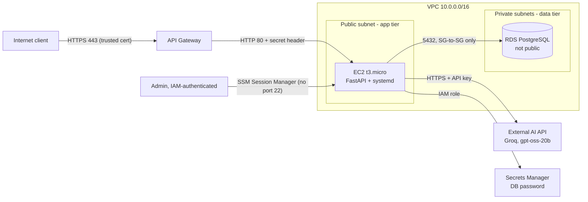

# Journal API – AWS Deployment

**Public base URL:** `https://<API-ID>.execute-api.us-east-1.amazonaws.com`  (stack output `ApiBaseUrl`)
**Deployed with:** `journal-stack.yaml` (CloudFormation, one stack, region `us-east-1`)

## Architecture

- **Public path:** client → API Gateway (HTTPS) → EC2 port 80. API Gateway adds a secret `X-Origin-Verify` header (stored in Secrets Manager); the app returns 403 to any request without it.
- **Private path:** EC2 → RDS on 5432 (DB security group allows only the app security group; subnets have no internet route).
- **Admin path:** SSM Session Manager over IAM auth. No SSH port, no key pairs.

## Services selected

| Need | Service | Why |
|---|---|---|
| HTTPS + trusted cert | API Gateway HTTP API default `*.execute-api.amazonaws.com` cert | No domain purchase needed |
| App tier | EC2 t3.micro + systemd | Cheapest, restarts on crash/reboot |
| DB tier | RDS PostgreSQL db.t4g.micro, private, encrypted | Data survives app restarts |
| Secrets | RDS-managed DB password + generated origin-header secret in Secrets Manager | Nothing in code, template or logs |
| AI | Groq OpenAI-compatible API, `openai/gpt-oss-20b` | Free tier, Bedrock was blocked on my account (Free plan) |
| Admin | SSM Session Manager | Private, authenticated |
| Cost control | AWS Budgets (50% / 80% actual, 100% forecast) | Created before other resources |

## Expected cost (us-east-1, ~730 h/month)

| Item | ≈ USD/month |
|---|---|
| EC2 t3.micro | 7.60 |
| EBS 8 GB gp3 | 0.64 |
| Public IPv4 address | 3.65 |
| RDS db.t4g.micro | 11.68 |
| RDS 20 GB gp3 | 2.30 |
| Secrets Manager | 0.40 |
| API Gateway HTTP API / AI API (free tier) | < 1.00 |
| **Total** | **≈ 27** (about $0.90/day; deleted after submission) |

## Access controls
- DB: `PubliclyAccessible: false`, private subnets without internet route, SG ingress only from app SG, TLS required.
- App: port 80 open but every request must carry the secret header (else 403); IMDSv2 required; runs as non-root `journal` user.
- IAM: instance role limited to reading one secret, reading three secrets, and SSM.
- Credentials (DB password, AI API key, origin secret): in Secrets Manager, fetched at runtime; nothing in git or logs.

## AI model and safety controls
- Model: `openai/gpt-oss-20b` via Groq's OpenAI-compatible chat API, temperature 0.2, max 1500 tokens, low reasoning effort. API key kept in Secrets Manager.
- Entry text is treated as untrusted data (system prompt forbids following its instructions).
- Output must be JSON and is validated (sentiment ∈ positive/negative/neutral, non-empty summary and topics) or the API returns 502.
- Input fields limited to 2,000 characters; 20 s AI timeout so `/analyze` stays under 30 s.

## Evidence that constraints passed  *(fill in with your real outputs)*

| Constraint | Evidence |
|---|---|
| Public HTTPS, trusted cert, no redirects | `curl -i https://<URL>/health` → `200`, no `Location` header |
| DB private, app-only | `aws rds describe-db-instances ... --query 'DBInstances[0].PubliclyAccessible'` → `false`; `nc -zv <rds-endpoint> 5432` from laptop times out |
| Management ports private | `aws ec2 describe-security-groups` shows no port 22; `aws ssm start-session` works |
| Credentials not in git/logs | `git grep -i password` empty; secret ARN only in Secrets Manager |
| Survives session end / restart | `sudo systemctl restart journal`, then `GET /entries` still returns data |
| CRUD + AI analysis | `POST /entries` → 201 with `id`; `POST /entries/{id}/analyze` → 200 with `entry_id`, `sentiment`, `summary`, `topics` |
| Budget configured | Screenshot of AWS Budgets showing `<stack>-monthly` before provisioning |

## Limitation to fix before production
API Gateway → EC2 uses plain HTTP, port 80 is reachable from the internet (protected only by a secret header), and there is a single EC2 instance and single-AZ database. Production should put the app behind a private ALB via an API Gateway VPC link (or an ALB with an ACM certificate) for end-to-end TLS and no public app port, in front of an Auto Scaling group across two AZs, with Multi-AZ RDS and backups.

## Cleanup
`aws cloudformation delete-stack --stack-name journal` – then check Billing → Cost Explorer and confirm Budgets shows no unexpected spend.
